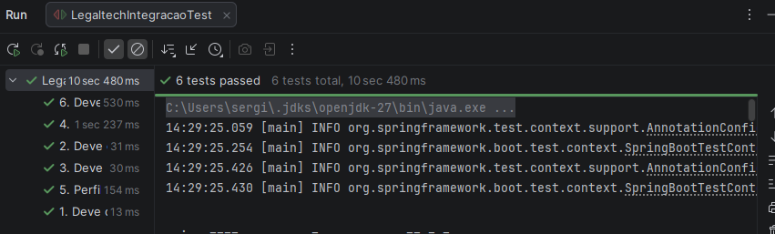
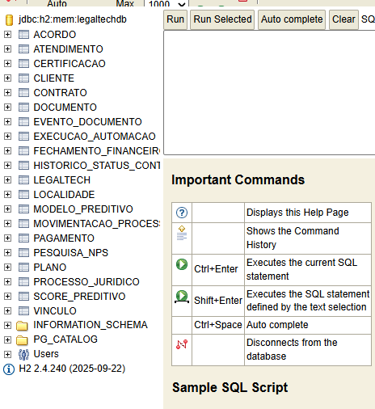
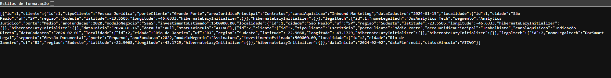
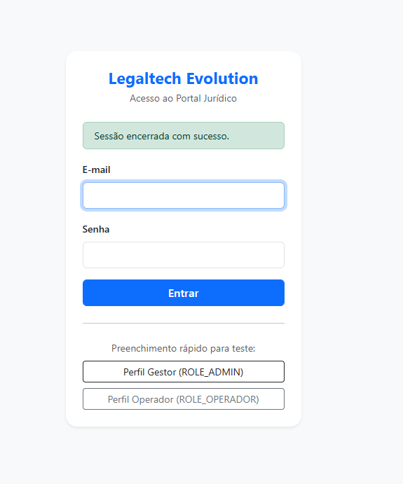
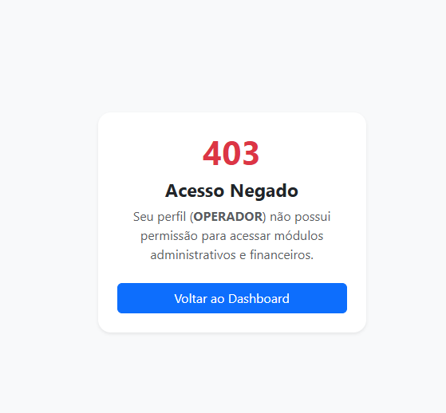
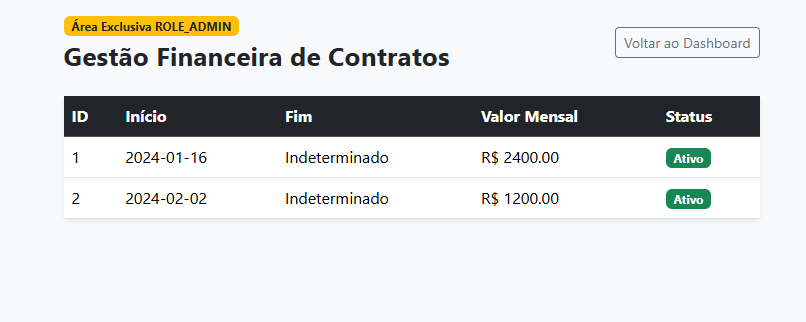

# Legaltech Evolution — Plataforma de Gestão Jurídica

Sistema web e API REST desenvolvidos em **Spring Boot** para gestão de vínculos entre clientes e legaltechs, contratos recorrentes, processos jurídicos, documentos e pagamentos. Projeto desenvolvido como Projeto Integrador (ESEG).

---

## Tecnologias Utilizadas

* **Linguagem & Runtime:** Java 17+
* **Framework Backend:** Spring Boot 4.1.2 (Web MVC, Data JPA, Validation, Security)
* **Frontend:** Thymeleaf, Thymeleaf Extras Spring Security 6, Bootstrap 5 (interface responsiva)
* **Banco de Dados:** H2 Database em memória (modo compatibilidade PostgreSQL) com carga automática via `schema.sql` e `data.sql`
* **Testes Automatizados:** JUnit 5, Spring Boot Test, MockMvc e Spring Security Test
* **Build & Produtividade:** Maven Wrapper (`mvnw`) e Lombok

---

## Estrutura e Evolução por Entregas

### 1ª Entrega — Diagnóstico, Requisitos e Modelagem
* **Diagnóstico do Sistema Legado:** Levantamento de gargalos operacionais no controle manual de contratos, prazos processuais, conformidade documental e faturamento recorrente.
* **Matriz de Requisitos Revisados e Novos:** Especificação dos requisitos funcionais e não funcionais, incluindo as regras de negócio de integridade de vínculos (`RN-01`), vigência contratual (`RN-02`), revisão humana obrigatória antes de assinatura/aprovação documental (`RN-04`), controle financeiro de pagamentos/estornos (`RN-05`) e cálculo automático de risco processual.
* **Diagrama de Classes e Modelos (Original vs. Proposto):** Evolução do modelo conceitual inicial para uma arquitetura relacional normalizada em **20 tabelas**, garantindo rastreabilidade histórica de status contratuais, eventos de documentos, movimentações processuais e auditoria financeira.
* **Justificativas Arquiteturais:** Adoção de normalização relacional para evitar redundância cadastral (localidades, clientes, legaltechs e planos) e separação em camadas (`model`, `repository`, `service`, `dto`, `controller`, `config`) para desacoplar regras de negócio da interface web.

### 2ª Entrega — Backend Spring Boot, Banco de Dados e Persistência
* **Aplicação Spring Boot Executável:** Configuração completa via Maven (`pom.xml` e Maven Wrapper) com inicialização embarcada na porta `8081`.
* **Banco de Dados e Scripts (`schema.sql` e `data.sql`):** Criação automática das 20 tabelas relacionais e carga inicial de registros de teste a cada inicialização.
* **Camada JPA, Serviços e Controllers:**
    * Entidades mapeadas com Jakarta Persistence (`@Entity`, relacionamentos `@ManyToOne`, `@OneToMany` e métodos de domínio) no pacote `model` e interfaces Spring Data JPA no pacote `repository`.
    * Regras de negócio implementadas na camada `service`, transferência de dados via `dto` e tratamento padronizado de erros em `exception`.
    * Endpoints RESTful em `controller` (como `GET /api/v1/vinculos`) com operações persistidas demonstráveis no banco H2 e retornadas em JSON.

### 3ª Entrega — Autenticação, Perfis de Acesso e Interface Responsiva
* **Fluxo de Login e Logout (`SecurityConfig`):** Autenticação baseada em formulário (`/login`) e encerramento seguro de sessão (`/logout` com invalidação de `HttpSession` e limpeza de cookies).
* **Dois Perfis com Permissões Distintas (RBAC):**
    * **`ROLE_ADMIN` (Gestor Jurídico):** Acesso irrestrito ao painel operacional, endpoints REST e módulo administrativo/financeiro (`/admin/gestao`).
    * **`ROLE_OPERADOR` (Operador):** Acesso ao painel operacional e consultas REST, com bloqueio automático (`HTTP 403`) ao tentar acessar rotas administrativas (`/admin/**`).
* **Páginas Responsivas com Thymeleaf Integrado:** Templates HTML5 + Bootstrap 5 adaptáveis a desktop e dispositivos móveis (`login.html`, `dashboard.html`, `admin-gestao.html` e `acesso-negado.html`), utilizando `thymeleaf-extras-springsecurity6` (`sec:authorize`, `sec:authentication`) para exibição dinâmica de dados e permissões.

### 4ª Entrega — Sistema Integrado, Testes, Evidências e Documentação
* **Sistema Integrado:** Integração ponta a ponta entre banco relacional H2, camada de persistência JPA, regras de negócio, APIs REST, controle de acesso Spring Security e portal web Thymeleaf.
* **Testes Automatizados (`LegaltechIntegracaoTest`):** Suíte com 6 testes de integração (JUnit 5 + MockMvc + Spring Security Test) validando carga do banco via JPA, cálculos de domínio, redirecionamento de usuários não autenticados, bloqueio `403` para `OPERADOR`, acesso liberado para `ADMIN` e logout.
* **Evidências de Execução:** Capturas de tela versionadas em `docs/evidencias/` comprovando testes, banco H2, API REST, autenticação e controle de acesso.
* **Histórico Git e Documentação:** Repositório estruturado com commits semânticos divididos por entrega e instruções completas de execução.

---

## Como Executar o Projeto

### Pré-requisitos
* JDK 17 ou superior instalado.

### Executar a Aplicação
1. Clone o repositório e acesse a pasta raiz do projeto:
   ```bash
   git clone [https://github.com/sergioliveiraa/legaltech-evolution.git](https://github.com/sergioliveiraa/legaltech-evolution.git)
   cd legaltech-evolution
   ```
2. Inicie o servidor utilizando o Maven Wrapper:
    * **Windows (PowerShell / CMD):**
      ```powershell
      .\mvnw spring-boot:run
      ```
    * **Linux / macOS:**
      ```bash
      ./mvnw spring-boot:run
      ```
3. A aplicação iniciará na porta **`8081`**.

### Executar os Testes Automatizados
```powershell
.\mvnw test
```

---

## Credenciais e Endpoints de Acesso

### Portal Web (`http://localhost:8081/login`)
A página de login conta com botões de preenchimento rápido para testar ambos os perfis:

| Perfil | E-mail (Usuário) | Senha | Permissões |
| :--- | :--- | :--- | :--- |
| **Gestor Jurídico (`ADMIN`)** | `admin@legaltech.com` | `admin123` | Acesso total ao Dashboard, APIs REST e Gestão Financeira (`/admin/gestao`) |
| **Operador (`OPERADOR`)** | `operador@legaltech.com` | `oper123` | Acesso ao Dashboard e APIs REST; bloqueado (`403`) em rotas `/admin/**` |

### Console do Banco de Dados H2
* **URL:** `http://localhost:8081/h2-console`
* **JDBC URL:** `jdbc:h2:mem:legaltechdb`
* **User Name:** `sa`
* **Password:** *(deixar em branco)*

### Principais Rotas e Endpoints
* `GET /login` — Página de autenticação.
* `POST /logout` — Encerramento de sessão.
* `GET /dashboard` — Painel principal responsivo (requer autenticação).
* `GET /admin/gestao` — Gestão financeira de contratos (restrito a `ROLE_ADMIN`).
* `GET /api/v1/vinculos` — Listagem REST em JSON dos vínculos persistidos.

---

## Evidências de Execução

| Evidência | Descrição |
| :--- | :--- |
|  | **1. Testes Automatizados:** Suíte `LegaltechIntegracaoTest` com 6/6 testes aprovados. |
|  | **2. Banco de Dados:** Estrutura das 20 tabelas criadas no H2 Console (`jdbc:h2:mem:legaltechdb`). |
|  | **3. Persistência REST:** Resposta JSON do endpoint `/api/v1/vinculos`. |
|  | **4. Autenticação:** Tela de login responsiva com seleção rápida de perfis. |
|  | **5. Autorização (Operador):** Bloqueio HTTP 403 ao tentar acessar área administrativa. |
|  | **6. Autorização (Admin):** Acesso liberado à tabela financeira de contratos. |